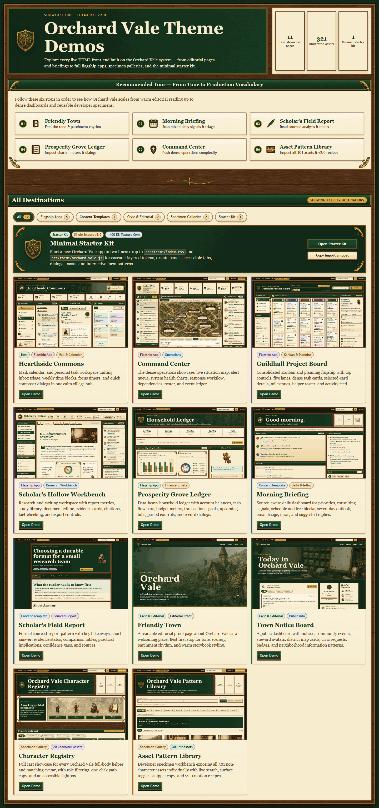
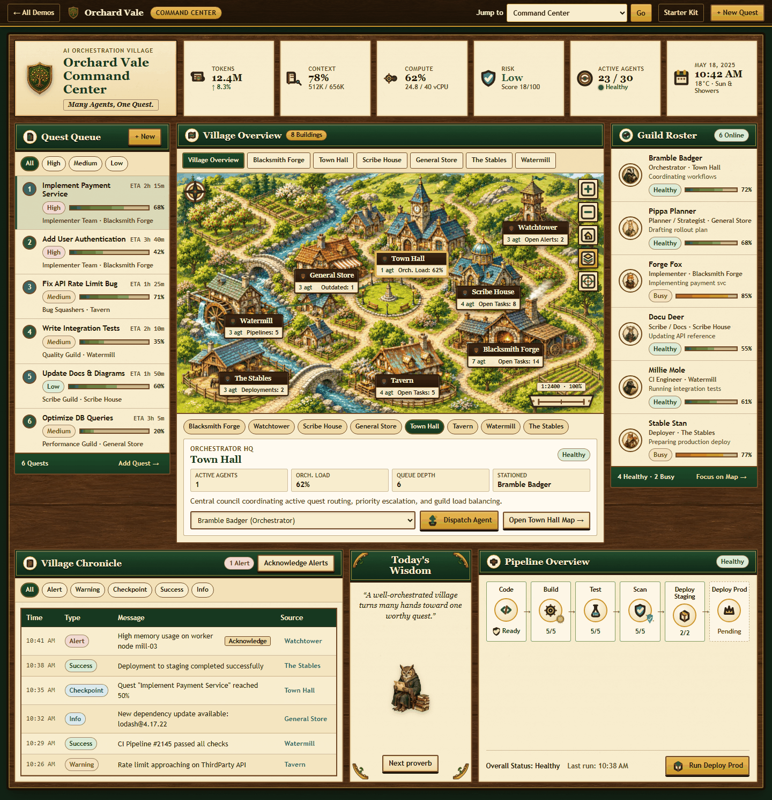
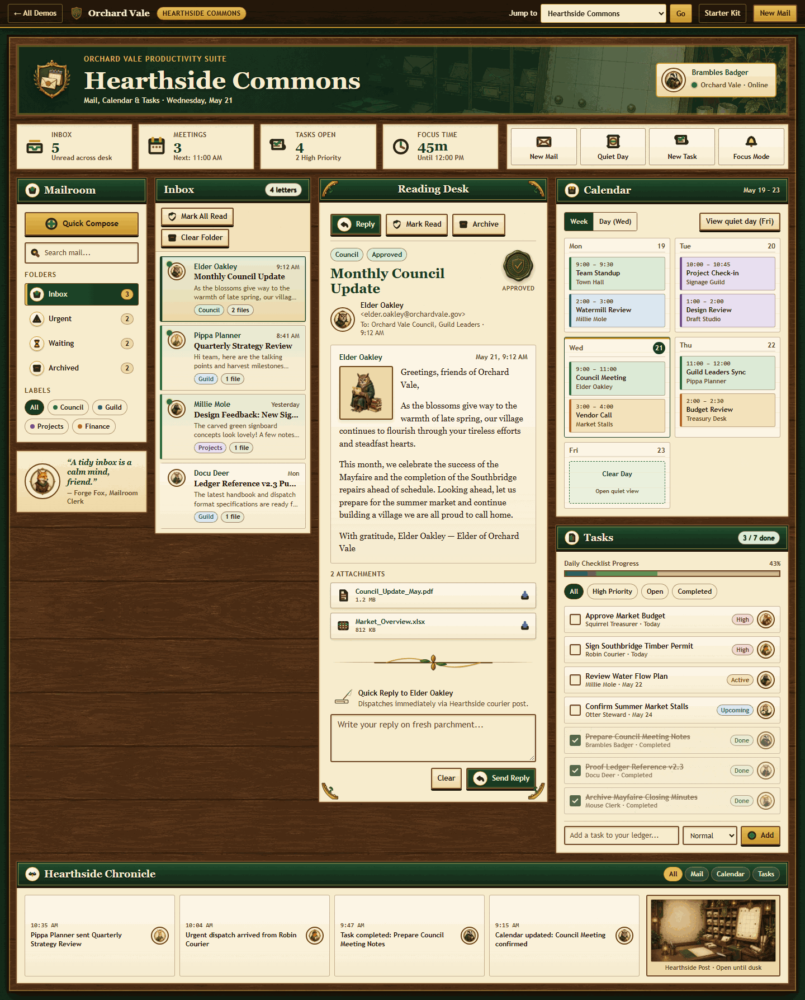
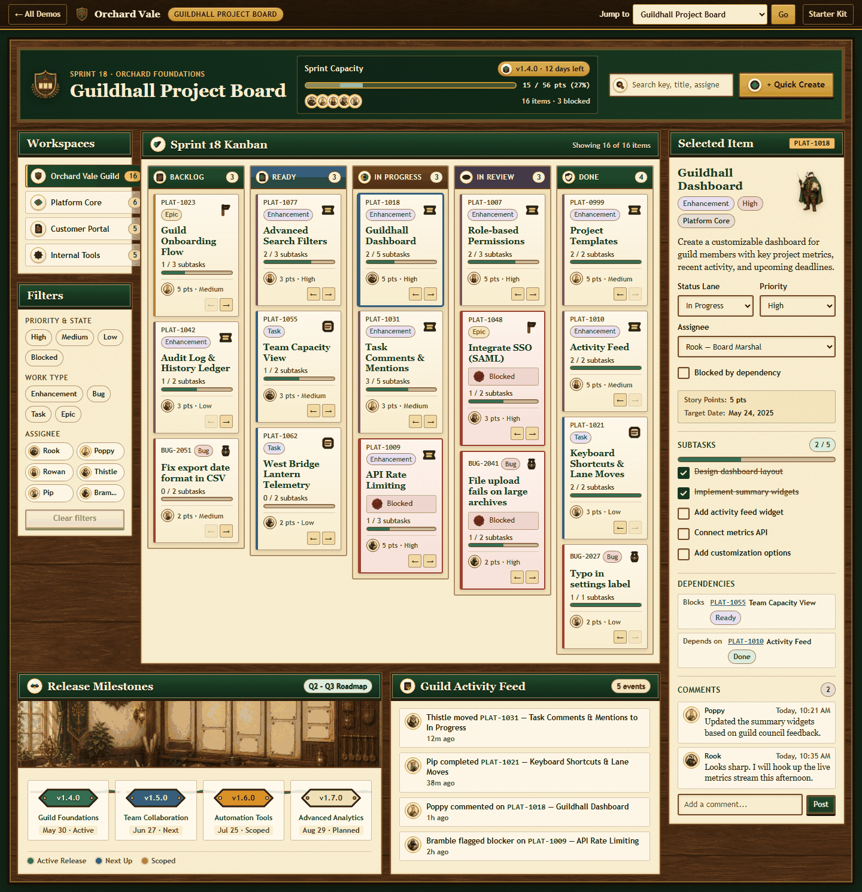
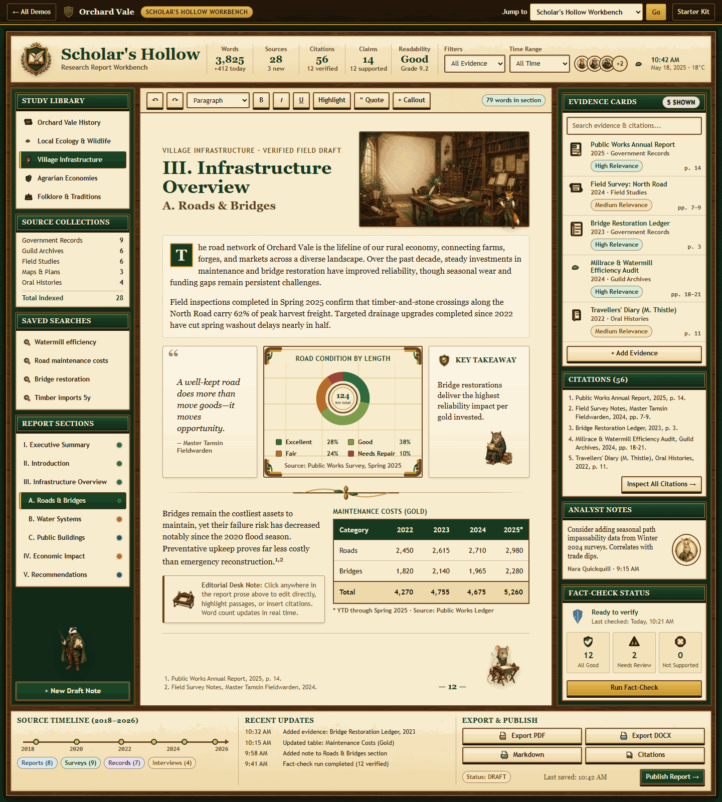
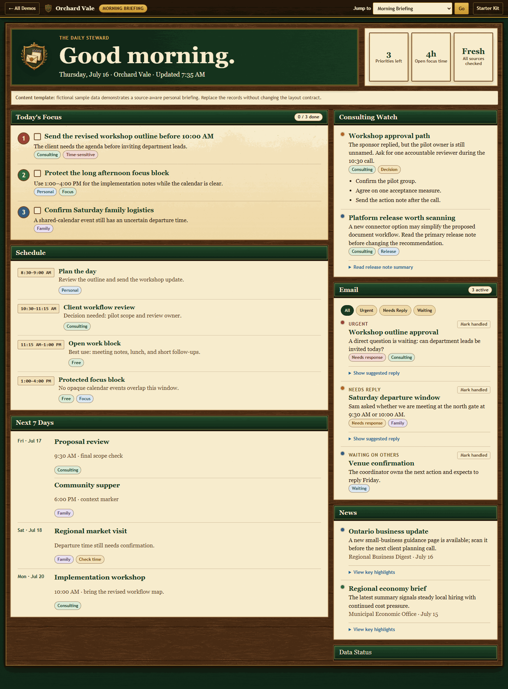
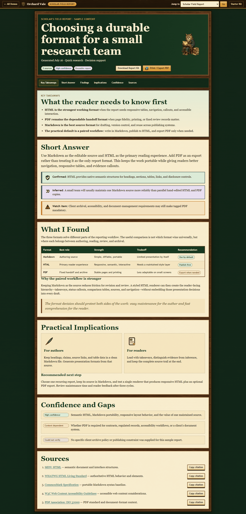
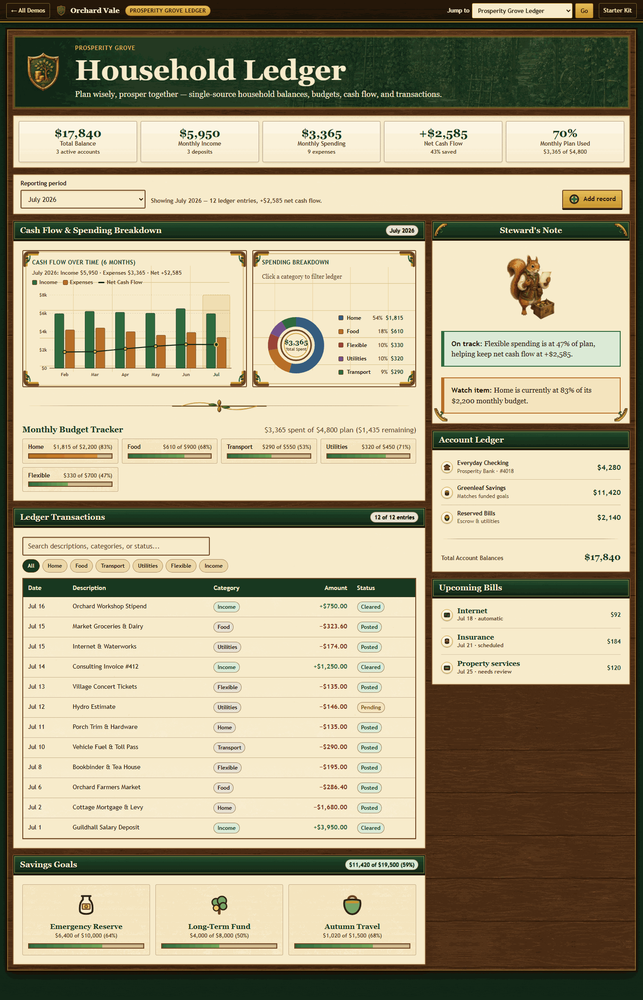
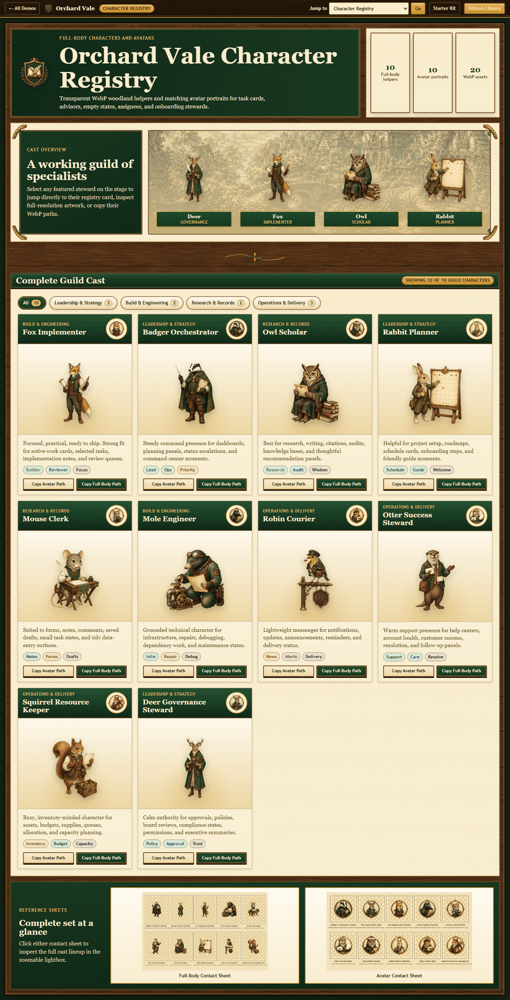
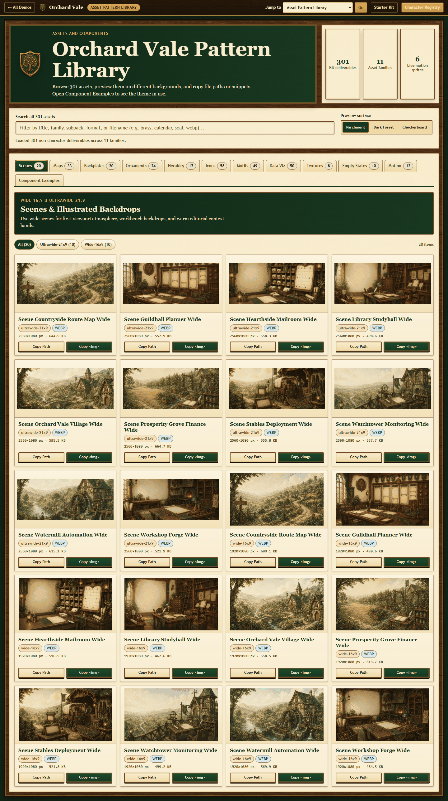

# Orchard Vale Theme Kit

Welcome to Orchard Vale!!

Orchard Vale is a richly illustrated storybook-village UI theme for HTML front-ends. It blends practical SaaS/product interface patterns with parchment panels, carved wood frames, dark forest-green headers, brass trim, heraldry, illustrated maps, guild-like dashboards, and a cast of woodland helpers.

The goal is not to make a generic fantasy skin. The goal is to make serious interfaces feel handcrafted, warm, readable, and distinctive.

[Explore the complete Orchard Vale demo collection live](https://j-loquat.github.io/Orchard-Vale-Theme/), or [browse the demo source](demo/index.html) in this repository.

[](https://j-loquat.github.io/Orchard-Vale-Theme/)

## Highlights

- **Single-import v2.0 theme architecture**: import [src/theme/index.css](src/theme/index.css) and zero-dependency [src/theme/orchard-vale.js](src/theme/orchard-vale.js) (`window.OrchardVale`) with no build step required.
- **Cascade-layered and subtree-safe**: tokens, base styles, components, and layouts live in `@layer ov.tokens, ov.base, ov.components, ov.layouts` scoped under `.ov-theme`, so app CSS overrides cleanly without specificity battles.
- **WCAG AA contrast and craft utilities**: verified across 44 foreground/background pairs, with asset-backed framing (`.ov-panel--ornate`, `.ov-divider`, `.ov-icon-badge`, `.ov-chart-frame`, `.ov-empty-state`, `.ov-sprite--*`), accessible dialogs, tabs, toasts, print-safe rules, and reduced-motion support.
- **Interactive demo suite**: all 12 demos plus [starter/index.html](starter/index.html) run on the shared v2.0 theme layer with real vanilla JS interactivity and a unified `.ov-demo-bar` navigator.
- **WebP-optimized asset pack**: 321 deliverables (225 SVG, 83 WebP, 13 PNG) indexed by `asset-manifest.json` / `asset-manifest.js`, bringing the runtime asset footprint down 86% from ~221 MiB to ~30.6 MiB while preserving 66 raw PNG masters in [art-sources/](art-sources/).
- **Developer specimen workbench**: browse, search, preview live motion, and copy ready-to-use snippets for all 301 non-character assets in [Asset Pattern Library](demo/asset-pattern-library.html).

## Demo Tour

Start with the [live demo directory](https://j-loquat.github.io/Orchard-Vale-Theme/). It explains every demo and links to each page.

| Demo source | Purpose | Live page |
| --- | --- | --- |
| [Friendly Town Article](demo/friendly-town.html) | A simple editorial proof page for tone, scenery, parchment rhythm, and warm storybook styling. | [Open live](https://j-loquat.github.io/Orchard-Vale-Theme/demo/friendly-town.html) |
| [Town Notice Board](demo/town-notice-board.html) | A medium-density public information board with interactive notice filters, event details, steward avatars, and badges. | [Open live](https://j-loquat.github.io/Orchard-Vale-Theme/demo/town-notice-board.html) |
| [Morning Briefing](demo/orchard-morning-briefing.html) | A generic mixed-information daily brief with priorities, consulting watch, schedule, lookahead, email triage, news, replies, and source health. | [Open live](https://j-loquat.github.io/Orchard-Vale-Theme/demo/orchard-morning-briefing.html) |
| [Scholar's Field Report](demo/orchard-research-report.html) | A generic sourced-research template with takeaways, evidence status, comparison tables, implications, confidence gaps, and sources. | [Open live](https://j-loquat.github.io/Orchard-Vale-Theme/demo/orchard-research-report.html) |
| [Hearthside Commons](demo/hearthside-commons.html) | A productivity suite for mail, calendar, and tasks with folder switching, message reader, interactive calendar, and task management. | [Open live](https://j-loquat.github.io/Orchard-Vale-Theme/demo/hearthside-commons.html) |
| [Command Center](demo/command-center.html) | A flagship operations dashboard featuring the interactive Village Tableau, 6 switchable district maps, alert queue, response workflow, and event ledger. | [Open live](https://j-loquat.github.io/Orchard-Vale-Theme/demo/command-center.html) |
| [Guildhall Project Board](demo/guildhall-project-board.html) | A flagship 3-column interactive Kanban board (consolidating the former Guildhall Planner) with filters, card movement, task details, milestones, and activity feed. | [Open live](https://j-loquat.github.io/Orchard-Vale-Theme/demo/guildhall-project-board.html) |
| [Scholar's Hollow Workbench](demo/scholars-hollow-workbench.html) | A research-and-writing workbench with interactive document editing, evidence cards, citations, fact-check controls, inline charts, and export actions. | [Open live](https://j-loquat.github.io/Orchard-Vale-Theme/demo/scholars-hollow-workbench.html) |
| [Prosperity Grove Ledger](demo/prosperity-grove-ledger.html) | A finance and household-ledger dashboard with real multi-month math, live SVG income/expense and donut charts, goals, bills, and add-record dialog. | [Open live](https://j-loquat.github.io/Orchard-Vale-Theme/demo/prosperity-grove-ledger.html) |
| [Character Registry](demo/character-gallery.html) | A large-format interactive gallery of every final full-body character and matching avatar. | [Open live](https://j-loquat.github.io/Orchard-Vale-Theme/demo/character-gallery.html) |
| [Asset Pattern Library](demo/asset-pattern-library.html) | A Developer Specimen Workbench exposing all 301 non-character assets with live search, copyable snippets, live motion playback, and composed UI recipes. | [Open live](https://j-loquat.github.io/Orchard-Vale-Theme/demo/asset-pattern-library.html) |
| [Minimal Starter](starter/index.html) | A clean, copy-ready starting page wired to `src/theme/index.css` and `src/theme/orchard-vale.js`. | [Open live](https://j-loquat.github.io/Orchard-Vale-Theme/starter/index.html) |

## Screenshots

### Operations Dashboard



### Mail, Calendar & Tasks



### Project Board



### Research Workbench



### Morning Briefing Template



### Sourced Research Report Template



### Finance And Ledger Dashboard



### Character Registry



### Pattern Library



## Asset Families

The reusable runtime assets live under [src/assets/orchard-vale](src/assets/orchard-vale) (321 deliverables: 225 SVG, 83 WebP, 13 PNG; ~30.6 MiB total on disk). Machine-readable indexes live in `asset-manifest.json` and `asset-manifest.js`, while 66 raw PNG masters are archived in [art-sources/](art-sources/).

| Family | Use |
| --- | --- |
| [Scenes](src/assets/orchard-vale/scenes) | 20 wide and ultrawide WebP illustrated backdrops for app shells, hero areas, workbenches, and dashboards. |
| [Maps](src/assets/orchard-vale/maps) | 9 WebP village/district/route map backgrounds and 24 SVG pins, markers, controls, scale plaques, and compass assets. |
| [Characters](src/assets/orchard-vale/characters) | 20 WebP assets (10 full-body helpers and 10 matching avatars) for rosters, comments, empty states, side panels, and contextual guidance. |
| [Heraldry](src/assets/orchard-vale/heraldry) | 17 WebP crests, seals, shield frames, approval marks, review marks, and app identity assets. |
| [Icons](src/assets/orchard-vale/icons) | 58 practical SVG UI icons for actions, navigation, status, data, finance, infrastructure, exports, and workflow. |
| [Motifs](src/assets/orchard-vale/motifs) | 49 domain SVG symbols for AI, CRM, finance, operations, productivity, project, and research screens. |
| [Backplates](src/assets/orchard-vale/backplates) | 20 SVG buttons, fields, ribbons, labels, badges, tabs, and reusable component surfaces. |
| [Ornaments](src/assets/orchard-vale/ornaments) | 24 SVG corners, dividers, hinges, rivets, frames, scroll caps, ribbon tails, and flourishes. |
| [Data Viz](src/assets/orchard-vale/data-viz) | 50 SVG chart frames, meters, ledger rules, timeline plaques, tooltips, callouts, and category symbols. |
| [Textures](src/assets/orchard-vale/textures) | 7 WebP seamless surfaces (parchment, signboard, wood, walnut, brass, watercolor wash) and 1 PNG ink-speckle overlay. |
| [Empty States](src/assets/orchard-vale/empty-states) | 10 horizontally centered WebP illustrated empty states and spot illustrations. |
| [Motion](src/assets/orchard-vale/motion) | 12 PNG assets (6 spritesheets and 6 static previews) for small theme animations. |

The most useful browsing pages and references are:

- [Character Registry](demo/character-gallery.html)
- [Asset Pattern Library](demo/asset-pattern-library.html)
- [Asset Inventory](docs/asset-inventory.md)
- [Asset Generation Plan](docs/asset-generation-plan.md)
- [GitHub Publishing Checklist](docs/github-publishing-checklist.md)

## Design Guide

The canonical design documentation is [docs/design.md](docs/design.md) (with a quick summary in [DESIGN.md](DESIGN.md) and the pixel-faithful 1672×941 reference artboard specification in [docs/design-reference-dashboard.md](docs/design-reference-dashboard.md)).

It covers:

- The Orchard Vale v2.0 aesthetic model, cascade-layered CSS architecture, and `window.OrchardVale` behavior helpers.
- Verified WCAG AA color tokens, surface context rules, typography, spacing, craft utilities, print, and reduced-motion rules.
- How to use storybook illustration without sacrificing product readability.
- How to translate image-generation mock-ups into real HTML/CSS/JS front-ends.

## Using The Kit

This repository is intentionally simple. You can open any demo HTML file directly in a browser over `file://` or serve it statically.

```text
demo/index.html
```

For a new page:

1. Start with the [minimal starter](starter/index.html) or the demo closest to your target layout.
2. Load the single-import theme stylesheet and optional zero-dependency helper script:

```html
<link rel="stylesheet" href="../src/theme/index.css">
<script src="../src/theme/orchard-vale.js" defer></script>
```

3. Add `class="ov-theme"` to `<body>` (for a full-page canvas) or to any embedded container (subtree-safe).
4. Reuse assets from [src/assets/orchard-vale](src/assets/orchard-vale) and follow [docs/design.md](docs/design.md) as the visual contract.
5. Keep real interface controls as semantic HTML/CSS/JS. Use images for atmosphere, identity, ornament, maps, helpers, and empty states.

All 12 demos and `starter/index.html` now run on the shared v2.0 theme (`src/theme/index.css` + `src/theme/orchard-vale.js`) with real vanilla JS interactivity—including filters, dialogs, tabs, live charts, card movement, map switching, clipboard copy, and toast notifications.

Run the dependency-free validation suite and HTML image-optimization check with:

```text
npm run validate
npm run optimize:images:check
```

## Optional Codex Pet

The kit includes an Orchard Badger pet for Codex in [pets/orchard-badger](pets/orchard-badger). To make it available on your computer, copy the entire `orchard-badger` folder into your personal Codex pets directory:

```text
~/.codex/pets/orchard-badger/
```

On Windows, the equivalent location is `%USERPROFILE%\.codex\pets\orchard-badger\`. After copying it, refresh the pet list in **Codex Settings > Pets** and select **Orchard Badger**. In an interactive Codex CLI session, you can also open the pet picker with `/pets`. See the [official Codex pets documentation](https://learn.chatgpt.com/docs/pets) for current interface and terminal support details.

## Repository Structure

```text
index.html                              Root redirect to demo/index.html for GitHub Pages.
README.md                               Public overview, demo tour, screenshots, and quick start.
DESIGN.md                               Concise design system pointer and production entry points.
AGENTS.md                               Working brief for coding agents modifying the kit.
CONTRIBUTING.md                         Design principles and validation checklist for contributors.
CHANGELOG.md                            Version history and release notes.
package.json                            Package exports and validation/optimization scripts.
LICENSE                                 MIT license.
docs/
  design.md                             Canonical Orchard Vale v2.0 adaptive design system guide.
  design-reference-dashboard.md         Legacy 1672x941 pixel-faithful reference dashboard spec.
  asset-generation-plan.md              Asset category plan and generation progress record.
  asset-inventory.md                    Runtime and archived asset inventory and manifest guide.
  github-publishing-checklist.md        Pre-publish checklist for GitHub and GitHub Pages.
  licensing-and-provenance.md           Code, artwork, reference, and reuse provenance notes.
art-sources/
  Archived raw PNG masters (~170 MB) separated from the runtime asset tree.
references/
  Original reference mock-ups used to develop the visual language.
pets/
  Optional Codex pets that users can copy into their personal .codex directory.
src/
  assets/orchard-vale/
    321 optimized runtime assets (SVG, WebP, PNG) plus asset-manifest.json and asset-manifest.js.
  theme/
    index.css                           Single-import v2.0 entry point.
    orchard-vale.css                    Tokens, base surfaces, surface context, focus, motion, print.
    orchard-components.css              Reusable UI components and asset-backed craft utilities.
    orchard-layouts.css                 Responsive shells and layout recipes.
    orchard-vale.js                     Zero-dependency progressive helpers (window.OrchardVale).
demo/
  index.html                            Visual directory linking to every demo.
  *.html / *.css / *.js                 12 interactive showcase demos built on src/theme/.
  README.md                             Demo catalog and interaction summary.
  screenshots/                          Desktop and mobile showcase captures.
starter/
  index.html                            Minimal page composed from src/theme/index.css + orchard-vale.js.
scripts/
  validate-theme.mjs                    HTML, CSS, JS, asset, magic-byte, contrast, and link validator.
  optimize-html-images.mjs              Injects loading, decoding, and width/height image attributes.
```

## Contributing

See [CONTRIBUTING.md](CONTRIBUTING.md) for the design principles and validation checklist for adding demos or assets.

## Notes On Generated Assets

This kit was built as an original Orchard Vale theme exploration with AI-assisted image generation and hand-authored HTML/CSS/JS composition. The assets are intended to be used as a cohesive visual system rather than copied one-off decorations.

See [Licensing And Asset Provenance](docs/licensing-and-provenance.md) for the code, artwork, reference, and reuse notes.

## License

MIT. See [LICENSE](LICENSE) and [Licensing And Asset Provenance](docs/licensing-and-provenance.md).
