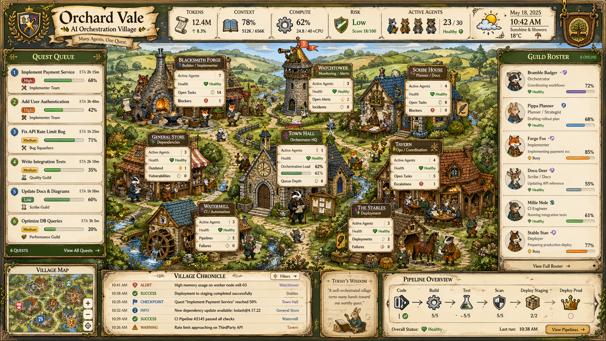

# Orchard Vale Reference Dashboard Spec (1672×941 Artboard)

> **Scope note:** This document preserves the legacy pixel-faithful measurement spec for recreating the original `references/orchard-vale-dashboard.png` concept artboard. For building adaptive Orchard Vale v2.0 applications, use the canonical design system in [`docs/design.md`](design.md) and the shipped theme in [`src/theme/index.css`](../src/theme/index.css).
>
> **Class naming note:** Every example class in this file uses the `.ov-ref-*` prefix so nothing collides with production `.ov-*` classes in `src/theme/`.



## Source Frame

- Source image: `references/orchard-vale-dashboard.png`
- Native canvas: `1672 × 941`
- Aspect ratio: `1.777` (close to 16:9)
- Composition model: framed dashboard over an illustrated village scene
- Visual density: high; almost every region carries useful operational information
- Primary metaphor: an AI orchestration village management game

All measurements below are based on the native `1672 × 941` canvas. When scaling, preserve proportions first, then preserve minimum text sizes for readability (`13px` dense floor, `16px` body default).

## Layout Blueprint

The screen is built from five major zones:

| Zone | Native Bounds | Purpose |
| --- | ---: | --- |
| Outer carved frame | `0,0 1672x941` | Dark wood/brass fantasy container |
| Top command strip | `0,0 1672x133` | Brand, metrics, date/weather, crest |
| Left quest rail | `14,137 286x574` | Current work queue |
| Center village map | `300,119 1078x628` | Main orchestration tableau |
| Right guild rail | `1378,137 280x613` | Active agent roster |
| Bottom status band | `14,748 1644x183` | Map, chronicle, wisdom, pipeline |

Use a single fixed artboard for exact recreation. For responsive implementations (such as [`demo/command-center.html`](../demo/command-center.html)), keep the central village first, then stack the quest rail, roster, and bottom modules below it.

```css
:root {
  --ov-ref-canvas-w: 1672px;
  --ov-ref-canvas-h: 941px;
  --ov-ref-top-h: 133px;
  --ov-ref-left-w: 286px;
  --ov-ref-right-w: 280px;
  --ov-ref-bottom-h: 183px;
  --ov-ref-gutter: 8px;
}
```

## Native Type Scale

| Use | Size | Weight/Style | Notes |
| --- | ---: | --- | --- |
| Main title `Orchard Vale` | `46-52px` | bold serif | Black ink, slight shadow |
| Section title | `20-24px` | small-caps serif | Cream text on green ribbon |
| Metric value | `24-30px` | bold serif or UI | Large enough to scan |
| Metric label | `14-16px` | uppercase serif | Centered above value |
| Quest title | `13-15px` | bold UI | Dense but readable |
| Body labels | `13-16px` | UI | Use short lines; `16px` is the shared-theme default |
| Log rows | `13-14px` | UI/mono | Compact table rhythm without sacrificing readability |

## Reference Material Approximations

In production v2.0 pages, use `.ov-frame`, `.ov-panel`, `.ov-ribbon`, and `.ov-meter` from [`src/theme/orchard-components.css`](../src/theme/orchard-components.css). The snippets below record the fixed-artboard visual approximations for exact screenshot study:

```css
.ov-ref-frame {
  width: 1672px;
  height: 941px;
  color: var(--ov-ink);
  background:
    linear-gradient(90deg, rgba(255, 255, 255, .05), transparent 18%, rgba(0, 0, 0, .25)),
    repeating-linear-gradient(90deg, #201208 0 8px, #2c190a 8px 18px);
  border: 4px solid #0d0804;
  box-shadow:
    inset 0 0 0 2px var(--ov-brass-dark),
    inset 0 0 0 5px var(--ov-brass),
    inset 0 0 24px rgba(0, 0, 0, .75);
}

.ov-ref-parchment {
  background:
    radial-gradient(circle at 20% 15%, rgba(255, 255, 255, .32), transparent 22%),
    radial-gradient(circle at 80% 80%, rgba(125, 78, 25, .16), transparent 26%),
    linear-gradient(#f6e9cb, #ead0a0);
  border: 2px solid var(--ov-wood);
  border-radius: 6px;
  box-shadow:
    inset 0 0 0 1px rgba(199, 148, 47, .75),
    inset 0 0 18px rgba(121, 78, 27, .24),
    0 3px 0 rgba(30, 18, 7, .65);
}

.ov-ref-ribbon {
  min-height: 36px;
  color: #f8e9b5;
  background: linear-gradient(#2b641f, #153915);
  border: 2px solid var(--ov-brass-dark);
  box-shadow:
    inset 0 0 0 1px var(--ov-brass),
    inset 0 6px 0 rgba(255, 255, 255, .06),
    0 2px 0 rgba(0, 0, 0, .55);
  font-family: var(--ov-display);
  text-shadow: 1px 1px 0 #120b05;
}
```

## Top Command Strip

The top strip combines a large identity banner with six operational metric cards and a weather/date module.

Native layout:

- Left crest block: `16,17 118x101`
- Brand banner: `131,17 323x109`
- Metric cards: start around `465,18`; each roughly `145-160px` wide
- Weather/date card: `1308,21 220x91`
- Orchard crest: `1534,16 112x107`

### Brand Block

- Title: `Orchard Vale` (on a torn parchment banner)
- Subtitle: `AI Orchestration Village` (flanked by tiny leaf/bee ornaments)
- Motto ribbon: `Many Agents, One Quest.` (smaller scroll banner below)
- Left crest: shield + crown + laurel

### Metric Cards

| Label | Value | Detail |
| --- | ---: | --- |
| Tokens | `12.4M` | `up 8.3%` |
| Context | `78%` | `512K / 656K` |
| Compute | `62%` | `248 / 40 vCPU` |
| Risk | `Low` | `Score 18/100` |
| Active Agents | `23 / 30` | `Healthy` |
| Weather/Date | `May 18, 2025`, `10:42 AM` | `Sunshine & Showers`, `18 deg C` |

## Center Village Tableau

Native bounds:

- Map area: approximately `300,119 1078x628`
- Horizon begins near `y=120`
- Main roads converge around Town Hall at center-lower area
- Buildings act as service nodes, each with a dark wood label plaque and parchment detail table

Required building/service mapping:

| Building | Role | Approx Position |
| --- | --- | ---: |
| Blacksmith Forge | Builder / Implementer | `485,155` |
| Watchtower | Monitoring / Alerts | `867,175` |
| Scribe House | Planner / Docs | `1125,182` |
| General Store | Dependencies | `406,374` |
| Town Hall | Orchestrator HQ | `765,361` |
| Tavern | Ops / Coordination | `1082,391` |
| Watermill | CI / Automation | `548,567` |
| The Stables | Deployment | `964,574` |

### Building Callouts

Each callout (`125-150px` wide, `34-42px` dark wood header, `22-26px` detail rows, `2px` dark wood border with inner brass line) follows this structure:

```html
<section class="ov-ref-building-card">
  <header>
    <h3>Blacksmith Forge</h3>
    <p>Builder / Implementer</p>
  </header>
  <dl>
    <div><dt>Active Agents</dt><dd>7</dd></div>
    <div><dt>Health</dt><dd class="healthy">Healthy</dd></div>
    <div><dt>Open Tasks</dt><dd>14</dd></div>
    <div><dt>Blockers</dt><dd>1</dd></div>
  </dl>
</section>
```

### Village Illustration Rules

- Rolling green hills and river in background; light blue sky with soft clouds.
- Dense village buildings with stone, timber, thatch, and tile roofs connected by a curving road network.
- Small animal-like guild workers, flags, signposts, market stalls, carts, flowers, crates, and tools.
- River/waterfall and watermill at bottom-left; Town Hall centered low; Watchtower centered high; Tavern and stables lower-right.
- Keep the scene bright and storybook-like; make callout overlays opaque enough to read rather than darkening the village.

## Left Quest Queue

Native bounds: `14,137 286x574` (header `21,143 270x38`, six rows ~`84-88px` tall, footer `22,674 264x32`).

| # | Quest | ETA | Priority | Progress | Guild |
| ---: | --- | --- | --- | ---: | --- |
| 1 | Implement Payment Service | `2h 15m` | High | `68%` | Implementer Team |
| 2 | Add User Authentication | `3h 40m` | High | `42%` | Implementer Team |
| 3 | Fix API Rate Limit Bug | `1h 25m` | Medium | `71%` | Bug Squashers |
| 4 | Write Integration Tests | `2h 10m` | Medium | `35%` | Quality Guild |
| 5 | Update Docs & Diagrams | `1h 50m` | Low | `60%` | Scribe Guild |
| 6 | Optimize DB Queries | `3h 5m` | Medium | `20%` | Performance Guild |

Footer: `6 Quests` on the left, `View All Quests ->` on the right.

## Right Guild Roster

Native bounds: `1378,137 280x613` (header `1384,143 266x38` showing `Guild Roster` and `6 Online`, six rows ~`85-88px` tall, footer action `View Full Roster ->`).

| Agent | Role | Activity | Status | Load |
| --- | --- | --- | --- | ---: |
| Bramble Badger | Orchestrator | Coordinating workflows | Healthy | `72%` |
| Pippa Planner | Planner / Strategist | Drafting rollout plan | Healthy | `68%` |
| Forge Fox | Implementer | Implementing payment svc | Busy | `85%` |
| Docu Deer | Scribe / Docs | Updating API reference | Healthy | `55%` |
| Millie Mole | CI Engineer | Running integration tests | Healthy | `61%` |
| Stable Stan | Deployer | Preparing production deploy | Busy | `77%` |

## Bottom Status Band

| Module | Native Bounds | Purpose |
| --- | ---: | --- |
| Village Map | `17,725 269x202` | Mini-map with colored shield markers and `+` / `-` / target controls |
| Village Chronicle | `295,752 559x176` | Compact activity log table (`Filters +` button) |
| Today's Wisdom | `879,760 151x168` | Quote card: `"A well-orchestrated village turns many hands toward one worthy quest."` |
| Pipeline Overview | `1047,759 595x168` | 6-stage CI/CD pipeline (`Code`, `Build 5/5`, `Test 5/5`, `Scan 5/5`, `Deploy Staging 2/2`, `Deploy Prod` pending) |

### Village Chronicle Rows

| Time | Type | Message | Source |
| --- | --- | --- | --- |
| `10:41 AM` | Alert | High memory usage on worker node mill-03 | Watchtower |
| `10:38 AM` | Success | Deployment to staging completed successfully | Stables |
| `10:35 AM` | Checkpoint | Quest "Implement Payment Service" reached 50% | Town Hall |
| `10:32 AM` | Info | New dependency update available: lodash@4.17.22 | General Store |
| `10:29 AM` | Success | CI Pipeline #2145 passed all checks | Watermill |
| `10:26 AM` | Warning | Rate limit approaching on ThirdParty API | Tavern |

Pipeline Overview footer: `Overall Status: Healthy`, `Last run: 10:38 AM`, gold button `View Pipelines ->`.

## Spatial Rhythm & Fixed Artboard Skeleton

At native `1672 × 941`:

- Outer frame padding: `8-14px`; panel gap: `6-10px`; parchment card padding: `8-12px`
- Quest/roster row padding: `8-10px`; metric card padding: `8px`; building callout row gap: `3-5px`

```html
<main class="ov-ref-frame">
  <header class="ov-ref-topbar">
    <section class="ov-ref-crest ov-ref-crest--left"></section>
    <section class="ov-ref-brand"></section>
    <section class="ov-ref-metrics"></section>
    <section class="ov-ref-weather"></section>
    <section class="ov-ref-crest ov-ref-crest--right"></section>
  </header>

  <aside class="ov-ref-quest-queue"></aside>

  <section class="ov-ref-village">
    <article class="ov-ref-building-card blacksmith"></article>
    <article class="ov-ref-building-card watchtower"></article>
    <article class="ov-ref-building-card scribe-house"></article>
    <article class="ov-ref-building-card general-store"></article>
    <article class="ov-ref-building-card town-hall"></article>
    <article class="ov-ref-building-card tavern"></article>
    <article class="ov-ref-building-card watermill"></article>
    <article class="ov-ref-building-card stables"></article>
  </section>

  <aside class="ov-ref-guild-roster"></aside>

  <footer class="ov-ref-bottom-band">
    <section class="ov-ref-mini-map"></section>
    <section class="ov-ref-chronicle"></section>
    <section class="ov-ref-wisdom"></section>
    <section class="ov-ref-pipeline"></section>
  </footer>
</main>
```

```css
.ov-ref-frame { position: relative; width: 1672px; height: 941px; overflow: hidden; }
.ov-ref-topbar { position: absolute; left: 0; top: 0; width: 1672px; height: 133px; }
.ov-ref-quest-queue { position: absolute; left: 14px; top: 137px; width: 286px; height: 574px; }
.ov-ref-village { position: absolute; left: 300px; top: 119px; width: 1078px; height: 628px; }
.ov-ref-guild-roster { position: absolute; left: 1378px; top: 137px; width: 280px; height: 613px; }
.ov-ref-bottom-band { position: absolute; left: 14px; top: 748px; width: 1644px; height: 183px; }
```

## Responsive Translation & Quality Checklist

When adapting this fixed artboard to smaller screens:

1. Top metrics become a horizontally scrollable strip.
2. Village tableau remains first and uses an aspect-ratio container (keep at least `640px` wide before switching to a simplified map).
3. Quest queue and guild roster stack as full-width panels (minimum row height `72px`).
4. Chronicle and pipeline become separate sections; mini-map and wisdom card move below the main operational modules.

Pixel-faithful checklist:

- The page reads immediately as `Orchard Vale`, not a generic fantasy dashboard.
- The first viewport contains the full command dashboard, not a landing-page hero.
- Left quest rail, center village, right roster, and bottom chronicle are all visible at native size.
- Every major number and label from the screenshot is represented.
- Building callouts are anchored over a continuous village scene with opaque parchment/plaque backing for readability.
- The bottom pipeline uses icon stages connected by arrows, and progress bars/status chips share consistent state colors throughout.
