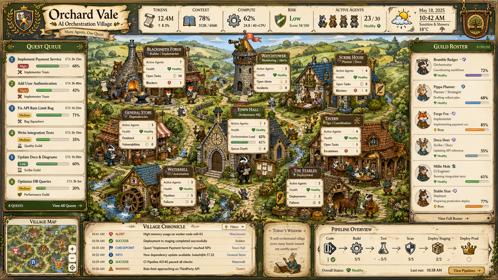

# Orchard Vale Design Guide

Orchard Vale is a handcrafted storybook-village UI design system for practical HTML front-ends. It combines warm parchment panels, dark forest-green headers, walnut and brass framing, illustrated maps, and woodland helper characters with real, accessible product interfaces.



## Using This Guide

This document is the canonical specification for the **Orchard Vale design system** shipped in `src/theme/`.

- **Adaptive Product Theme (this guide):** Use this document when building dashboards, reports, briefings, Kanban boards, ledgers, workbenches, productivity suites, or embedded widgets.
- **Pixel-Faithful 1672×941 Reference Artboard:** If you are recreating the original fixed-canvas `references/orchard-vale-dashboard.png` screenshot pixel for pixel, see [`docs/design-reference-dashboard.md`](design-reference-dashboard.md). That document isolates all fixed-artboard bounds and `.ov-ref-*` reference snippets so nothing collides with production `.ov-*` CSS.

Use the shipped files as the implementation reference.

- [`src/theme/index.css`](../src/theme/index.css) — single-import entry point that loads all CSS layers in cascade order.
  - [`src/theme/orchard-vale.css`](../src/theme/orchard-vale.css) — `@layer ov.tokens` and `@layer ov.base` (WCAG AA verified tokens, subtree-safe `.ov-theme`, automatic surface context, focus, reduced motion, and print-safe rules).
  - [`src/theme/orchard-components.css`](../src/theme/orchard-components.css) — `@layer ov.components` (reusable panels, ribbons, controls, dialogs, tabs, toasts, cards, tables, charts, and asset-backed craft utilities).
  - [`src/theme/orchard-layouts.css`](../src/theme/orchard-layouts.css) — `@layer ov.layouts` (responsive shells and layout recipes).
- [`src/theme/orchard-vale.js`](../src/theme/orchard-vale.js) — zero-dependency, `file://`-safe progressive helpers (`window.OrchardVale`).
- [Setup guide](../starter/index.html) — copy-ready HTML and steps for using Orchard Vale in a new or existing page.
- [`demo/asset-pattern-library.html`](../demo/asset-pattern-library.html) — Browse and copy 301 assets or try the [component examples](../demo/asset-pattern-library.html#recipes).
- [Live demo directory](https://j-loquat.github.io/Orchard-Vale-Theme/) — all 12 interactive reference demos in a browser.

## Visual Thesis

Orchard Vale should feel like a handcrafted village guildhall rather than a flat SaaS template or a generic fantasy tavern. Panels feel printed on warm parchment, framed in dark walnut and antique brass, and crowned by moss-green signboards. Operational density—metrics, tables, filters, charts, alerts, and timelines—must remain scannable and calm.

Where domain metaphors improve clarity, modern concepts map naturally:

- Tasks become quests or guild work.
- Agents or teammates become guild members or stewards.
- Services become village buildings or districts.
- Logs become chronicles.
- CI/CD becomes a pipeline procession.
- Health and risk become village safety signals.

Do not force fantasy nouns when standard product language is clearer. Mail can stay mail; budgets can stay budgets; the visual craft carries the theme.

## Theme Modes

Orchard Vale supports two distinct modes. Choose one before designing a screen:

- **Adaptive Product Theme Mode (default):** Keep the material system, typography, contrast contract, status language, and component grammar, while letting the layout follow the actual product workflow. Do not force a village map into every screen.
- **Pixel-Faithful Dashboard Mode:** Recreate the 16:9 `orchard-vale-dashboard.png` artboard using [`docs/design-reference-dashboard.md`](design-reference-dashboard.md).

## Reference Library

The theme kit includes five foundational reference mock-ups under [`references/`](../references/):

| Reference | File | App Type | Primary Lesson |
| --- | --- | --- | --- |
| Orchard Vale | `../references/orchard-vale-dashboard.png` | AI orchestration command center | Full village-map dashboard shell (`demo/command-center.html`) |
| Scholar's Hollow | `../references/scholars-hollow-workbench.png` | Research report workbench | Document editor plus evidence/citation rails (`demo/scholars-hollow-workbench.html`) |
| Prosperity Grove | `../references/prosperity-grove-ledger.png` | Household finance ledger | Real charts, ledgers, goals, bills, and advisor panels (`demo/prosperity-grove-ledger.html`) |
| Hearthside Commons | `../references/hearthside-commons-productivity.png` | Mail, calendar, and tasks | Conventional productivity layout in parchment UI (`demo/hearthside-commons.html`) |
| Guildhall Planner | `../references/guildhall-planner-board.png` | Project and team workflow | Interactive Kanban board, detail drawer, milestone timeline (`demo/guildhall-project-board.html`) |

These references prove that Orchard Vale is a design language, not one fixed screen. Across all of them, the shared grammar is:

- A carved dark wood outer shell or restrained wood/forest command frame.
- A parchment or green title banner with crest, subtitle, and subtle leaf ornaments.
- A top command strip with metrics, filters, active collaborators, or quick actions.
- Parchment panels with low-radius corners (`3-6px`), dark ink borders, brass inner hairlines, and subtle WebP paper textures.
- Dark moss-green section headers with brass trim and pale cream serif labels.
- Dense, readable rows, charts, cards, calendars, and tables.
- Small hand-drawn animal guild characters used intentionally as avatars, advisors, or contextual helpers.
- Bottom chronicle, timeline, or activity bands for recent events.
- Consistent status semantics: green healthy/done, amber warning/medium, red urgent/blocked, blue/purple category/selection.

## Architecture

### Single Import And Cascade Layers

Import the entire theme with one stylesheet and one optional script:

```html
<link rel="stylesheet" href="../src/theme/index.css">
<script src="../src/theme/orchard-vale.js" defer></script>
```

Every rule in `src/theme/` is placed inside explicit CSS Cascade Layers:

```css
@layer ov.tokens, ov.base, ov.components, ov.layouts;
```

Because unlayered CSS always outranks layered CSS, any page- or app-specific stylesheet can override Orchard Vale defaults cleanly without `!important` or specificity wars.

### Subtree-Safe `.ov-theme`

Apply `class="ov-theme"` in either of two ways:

- **Full-page mode:** `<body class="ov-theme">` (or any element with `.ov-theme.ov-theme--canvas`) applies the dark carved-wood page backdrop and base typography.
- **Embedded / subtree mode:** `<section class="ov-theme">` scopes box-sizing, typography, links, focus rings, and surface variables strictly inside that subtree without leaking onto the host page's `<body>`.

### Zero-Dependency Progressive Helpers (`window.OrchardVale`)

[`src/theme/orchard-vale.js`](../src/theme/orchard-vale.js) is a `file://`-safe IIFE with zero external dependencies that auto-initializes on `DOMContentLoaded` and exposes `window.OrchardVale`:

- **Accessible Tabs (`[data-ov-tabs]`):** Full ARIA tablist keyboard navigation (`ArrowLeft`/`ArrowRight` or `ArrowUp`/`ArrowDown` for vertical, `Home`/`End`), optional URL hash sync (`data-ov-tabs-hash`), and `ov:tabchange` custom events.
- **Native Dialogs (`dialog.ov-dialog`):** Declarative `[data-ov-dialog-open="id"]` and `[data-ov-dialog-close]` triggers, backdrop click-to-dismiss (opt out with `data-ov-dialog-static`), Escape handling, and automatic focus restoration to the opener. Programmatic API: `OrchardVale.openDialog(target, trigger)` and `OrchardVale.closeDialog(target)`.
- **Clipboard Copy (`[data-ov-copy]`):** Copies an attribute value or `[data-ov-copy-target="#selector"]` with temporary label confirmation, toast feedback, and `execCommand` fallback for strict `file://` contexts. Programmatic API: `OrchardVale.copyText(text)`.
- **Toast Notifications & Live Announcements:** `OrchardVale.toast(message, tone, options)` (`success`, `info`, `warning`, `danger`, pause-on-hover/focus) and `OrchardVale.announce(message, politeness)` (`polite` or `assertive` screen-reader regions).
- **Tooltip Escape Dismissal:** Pressing `Escape` dismisses active `.ov-tooltip` bubbles cleanly until pointer/focus leaves.
- **Shared Demo Bar (`[data-ov-demo-bar]`):** Enhances `<nav data-ov-demo-bar></nav>` into a consistent cross-demo navigator (with WCAG 3.2.2 keyboard-safe `<select>` + Go button and Starter Kit link).

## Tokens And WCAG AA Contrast Contract

All production tokens live in [`src/theme/orchard-vale.css`](../src/theme/orchard-vale.css). [`npm run validate`](../scripts/validate-theme.mjs) checks 44 token pairs against **WCAG 2.1 AA** contrast thresholds. Each foreground in a row is checked against each background in that row. Token names below omit the `--ov-` prefix.

| Use | Foregrounds | Backgrounds | Minimum ratio | Pairs |
| --- | --- | --- | ---: | ---: |
| Text, headings, and kickers on light surfaces | `ink`, `ink-soft`, `ink-muted`, `forest`, `brass-dark` | `paper`, `paper-warm`, `parchment` | 4.5:1 | 15 |
| Text and kickers on dark surfaces | `paper`, `brass-light` | `forest-black`, `forest`, `forest-mid` | 4.5:1 | 6 |
| Links on light surfaces | `link-light`, `link-light-hover` | `paper`, `paper-warm`, `parchment` | 4.5:1 | 6 |
| Links on dark surfaces | `link-dark`, `link-dark-hover` | `forest-black`, `forest` | 4.5:1 | 4 |
| Text on solid status fills | `paper` | `green`, `blue`, `red`, `purple` | 4.5:1 | 4 |
| Text on pale red | `red-ink` | `red-soft` | 4.5:1 | 1 |
| Text on pale amber | `amber-ink` | `amber-soft` | 4.5:1 | 1 |
| Light-surface focus rings | `focus-light` | `paper`, `paper-warm`, `parchment` | 3:1 | 3 |
| Dark-surface focus rings | `focus-dark` | `forest-black`, `forest`, `forest-mid` | 3:1 | 3 |
| Amber status marker | `amber` | `paper` | 3:1 | 1 |

### Palette Tokens

```css
:root {
  /* Ink */
  --ov-ink: #24180d;
  --ov-ink-soft: #594025;
  --ov-ink-muted: #5f4628;

  /* Paper and parchment */
  --ov-paper: #f8edcf;
  --ov-paper-warm: #efd9a7;
  --ov-parchment: #e2c37e;
  --ov-parchment-deep: #c9a866;
  --ov-white: #fffaf0;

  /* Wood and brass */
  --ov-wood-dark: #181006;
  --ov-wood: #2b1a0b;
  --ov-walnut: #704826;
  --ov-brass: #c9962e;
  --ov-brass-light: #e5bd58;
  --ov-brass-dark: #6c4215;

  /* Forest */
  --ov-forest-black: #0f2818;
  --ov-forest: #173820;
  --ov-forest-mid: #1c4a2a;
  --ov-green: #2f6b3f;
  --ov-green-soft: #dcebd7;

  /* Status fills and their companion text colors */
  --ov-blue: #355d7f;
  --ov-blue-soft: #dbe7f0;
  --ov-red: #9a4337;
  --ov-red-ink: #7d2f25;
  --ov-red-soft: #f1d9d2;
  --ov-amber: #b86f28;
  --ov-amber-ink: #754512;
  --ov-amber-soft: #f4e2bf;
  --ov-purple: #73508b;
  --ov-purple-soft: #e8dff0;
  --ov-gray-soft: #e8e1d2;

  /* Links and focus (switched automatically by surface context) */
  --ov-link-light: #1e5481;
  --ov-link-light-hover: #163f64;
  --ov-link-dark: #f6e2a8;
  --ov-link-dark-hover: #fff6d6;
  --ov-focus-light: #235f91;
  --ov-focus-dark: var(--ov-brass-light);
}
```

### Automatic Surface Context

Light surfaces (`.ov-panel`, `.ov-card`, `.ov-dialog`, `.ov-callout`, `.ov-empty-state`, `.ov-toast`, `.ov-table-wrap`, `.ov-light-surface`) automatically set `--ov-link`, `--ov-kicker`, and `--ov-focus` to high-contrast light-surface tokens. Dark surfaces (`body.ov-theme`, `.ov-frame`, `.ov-panel--green`, `.ov-panel-title`, `.ov-title-banner`, `.ov-ribbon`, `.ov-dark-surface`, `.ov-demo-bar`, `.ov-top-nav`, `.ov-dialog__header`) automatically switch them to high-contrast dark-surface tokens (`--ov-link-dark`, `--ov-brass-light`). Nested surfaces inherit from their nearest ancestor.

### Typography, Spacing, Elevation, Motion, And Textures

- **Offline-safe font stacks:** `--ov-display` & `--ov-body` (`Georgia, "Times New Roman", serif`), `--ov-ui` (`"Trebuchet MS", Arial, sans-serif`), `--ov-mono` (`Consolas, "Courier New", monospace`).
- **Type scale:** `--ov-text-xs` (`12px`), `--ov-text-sm` (`13px` dense floor), `--ov-text-md` (`16px` default body), `--ov-text-lg` (`18px`), `--ov-text-xl` (`24px`), fluid `--ov-text-2xl` and `--ov-text-display`.
- **Spacing & radii:** 4px grid (`--ov-space-1` through `--ov-space-8`, `4px` to `48px`); low-radius corners (`--ov-radius-sm: 3px`, `--ov-radius-md: 6px`, `--ov-radius-lg: 10px`, `--ov-radius-pill: 999px`).
- **Elevations & z-index:** `--ov-elev-1`, `--ov-elev-2`, `--ov-elev-3`, `--ov-elev-modal`, `--ov-inset-brass`; z-index scale from `--ov-z-base: 1` to `--ov-z-skip: 1200`.
- **Motion:** `--ov-dur-fast: 120ms`, `--ov-dur-base: 200ms`, `--ov-dur-slow: 320ms`, `--ov-dur-sprite: 900ms`, `--ov-ease-out`, `--ov-ease-in-out`.
- **WebP Texture Core (~400 KB total):** `--ov-tex-parchment`, `--ov-tex-parchment-aged`, `--ov-tex-wood-dark`, `--ov-tex-walnut`, `--ov-tex-signboard`, `--ov-tex-brass`, `--ov-tex-watercolor`, plus `--ov-tex-speckle` (transparent PNG ink overlay).

## Component And Craft Utility Grammar

Use the shipped classes in [`src/theme/orchard-components.css`](../src/theme/orchard-components.css) and [`src/theme/orchard-layouts.css`](../src/theme/orchard-layouts.css) before writing custom CSS:

| Product UI Need | Orchard Vale Treatment | Shipped Class Or Pattern |
| --- | --- | --- |
| App shell | Carved wood frame or restrained wood chrome | `.ov-page`, `.ov-shell`, `.ov-frame` |
| Demo navigation | Consistent top bar across showcase pages | `<nav data-ov-demo-bar>` / `.ov-demo-bar` |
| Page heading | Green identity banner with crest and supporting copy | `.ov-title-banner`, `.ov-header__identity`, `.ov-report-header` |
| Section header | Dark moss-green ribbon with brass inset border | `.ov-panel-title`, `.ov-ribbon` |
| Card / panel | Parchment surface with ink and brass structure | `.ov-panel`, `.ov-panel--aged`, `.ov-panel--green`, `.ov-card` (with `--green`, `--amber`, `--red`, `--blue`, `--purple`, `--interactive`) |
| Asset-backed framing | Brass corner brackets or carved wood corner ornaments | `.ov-panel--ornate` (`--sm`, `--lg`), `.ov-panel--wood-corners` |
| Section dividers | Hand-inked brass or vine horizontal rule | `.ov-divider`, `.ov-divider--vine`, `.ov-divider--plain` |
| Icon badges & seals | Medallion badges and heraldic wax/crest seals | `.ov-icon-badge` (`--sm`, `--lg`, `--square`), `.ov-seal` (`--sm`, `--lg`), `.ov-seal-row` |
| Navigation rail | Vertical list with active highlight and count pills | `.ov-nav-list`, `.ov-nav-list__count` |
| Tabs | Accessible parchment/green tab bar and panel | `.ov-tabs`, `.ov-tablist`, `.ov-tab`, `.ov-tabpanel` + `[data-ov-tabs]` |
| Dialog / modal | Native `<dialog>` with green header and parchment body | `dialog.ov-dialog` (`--wide`), `.ov-dialog__header`, `.ov-dialog__body`, `.ov-dialog__footer` |
| Table / ledger | Responsive ledger or chronicle with ruled rows | `.ov-table-wrap`, `.ov-table` |
| Charts & timelines | Framed real SVG/HTML charts and milestone plaques | `.ov-chart-frame`, `.ov-chart-bars`, `.ov-timeline`, `.ov-timeline-plaque` |
| Empty states | Centered WebP illustration with title and actions | `.ov-empty-state` (`--compact`), `.ov-empty-state__art`, `.ov-empty-state__title` |
| Micro-motion | Spritesheet animations (respects reduced motion) | `.ov-sprite` + `--lantern`, `--gear`, `--quill`, `--courier`, `--page`, `--shield` (`--paused`, `--once`) |
| Status badge & dot | Color-coded status pill and state indicator | `.ov-chip` (`--green`, `--amber`, `--red`, `--blue`, `--purple`), `.ov-status-dot` |
| Progress | Brass-edged meter with painted fill | `.ov-meter` |
| User / avatar | Heraldic portrait medallion | `.ov-avatar` (`--sm`, `--lg`) |
| Buttons & forms | Green, brass, paper, danger buttons and crafted inputs | `.ov-button` (`--brass`, `--paper`, `--danger`, `--sm`), `.ov-icon-button`, `.ov-input`, `.ov-select`, `.ov-textarea`, `.ov-check`, `.ov-fieldset` |
| Briefing & research | Priorities, events, day groups, evidence callouts, sources | `.ov-priority`, `.ov-event`, `.ov-time`, `.ov-day-group`, `.ov-callout` (`--confirmed`, `--inferred`, `--watch`, `--warning`), `.ov-source-row`, `.ov-source-list`, `.ov-details` |
| Feedback & hints | Toast stack, tooltips, keyboard keycaps | `.ov-toast-region`, `.ov-toast`, `.ov-tooltip`, `.ov-kbd` |

## Multi-App Design Cues And Layout Recipes

Use the layout that fits the product. Orchard Vale should be recognizable through materials and components, not through one repeated dashboard composition.

### Operations Or Command Center (`demo/command-center.html`)

- Top metric strip becomes resource counters.
- Main region features an interactive map or village tableau with switchable district views.
- Side rails show active queues, alerts, or guild stewards.
- Bottom strip acts as a live chronicle/event log and pipeline overview.

### Research Workbench (`demo/scholars-hollow-workbench.html`)

- Center workspace is a calm, legible parchment document with a practical formatting toolbar.
- Left rail is a study library with source collections and report sections.
- Right rail holds evidence cards, citations, analyst notes, and fact-check controls.
- Keep flourishes at panel edges, never inside the editable document body.

### Sourced Research Report (`demo/orchard-research-report.html`)

- Use `.ov-report`, `.ov-report-header`, `.ov-report-content`, and `.ov-report-section`.
- Lead with key takeaways and a short answer; distinguish confirmed evidence, inference, watch items, and warnings with `.ov-callout--*`.
- Keep comparisons in real `.ov-table` markup and ensure long reports print cleanly.

### Household Finance Ledger (`demo/prosperity-grove-ledger.html`)

- Use `.ov-finance-grid` for a data-first main column and contextual side rail.
- Render real charts (SVG income/expense bars, donut breakdowns, budget meters) inside `.ov-chart-frame` parchment panels rather than illustrated fakes.
- Pair ledgers, upcoming bills, and goals with a working period selector and native `<dialog>` add-record form.

### Mail, Calendar, And Tasks (`demo/hearthside-commons.html`)

- Preserve familiar productivity structure: folder rail, message list, message reader, ruled calendar grid, and task checklist.
- Keep standard nouns ("Inbox", "Calendar", "Tasks") while expressing the theme through parchment surfaces, brass dividers, woodland avatars, and crafted controls.

### Daily Briefing (`demo/orchard-morning-briefing.html`)

- Use `.ov-dashboard-grid` with a primary reading column and narrower watch/context rail.
- Lead with a strictly limited priority list (`.ov-priority`), separate schedule blocks (`.ov-event`, `.ov-time`) and lookahead (`.ov-day-group`), and tuck optional replies inside `.ov-details`.

### Project And Kanban Board (`demo/guildhall-project-board.html`)

- Use a focused 3-column interactive board with ornate green headers, count badges, compact cards, priority chips, and assignee medallions.
- Pair the board with workspace filters, a selected-task detail panel, milestone timeline, and activity feed. Avoid over-decorating every card.

## Accessibility, Reduced Motion, And Print Rules

### Interaction And Accessibility

- Use semantic HTML for all buttons, links, inputs, tabs, dialogs, disclosures, and tables.
- Give every page exactly one `main` landmark and one descriptive `h1`.
- Keep body text at `16px` (`--ov-text-md`) and dense supporting text at `13px` (`--ov-text-sm`) or larger.
- Never remove `:focus-visible`; let `--ov-focus` adapt automatically between light and dark surfaces.
- Provide meaningful `alt` text for informative images and `alt=""` for decorative images. Reserve dimensions (`width`/`height` or `aspect-ratio`) and run `npm run optimize:images`.
- Wrap wide tables in `.ov-table-wrap` so pages never overflow horizontally.
- Never place required text directly over busy illustration without an opaque parchment backing.

### Reduced Motion

`@media (prefers-reduced-motion: reduce)` in `src/theme/orchard-vale.css` disables smooth scrolling and zeroes out **both** `animation-duration`/`transition-duration` (`0.01ms !important`) **and** `animation-delay`/`transition-delay` (`0s !important`) so staggered reveals never stall invisible.

### Print-Safe Rules

`@media print` in `src/theme/orchard-vale.css` uses layered `!important` overrides (which outrank unlayered page CSS) to ensure every themed page prints cleanly as crisp dark ink (`#111`) on white paper (`#fff`), strips heavy textures, shadows, ornate corners, and interactive chrome (`.ov-demo-bar`, `.ov-top-nav`, `.ov-toast-region`, buttons, `[data-ov-print-hide]`), preserves color-adjusted status chips and meters, and prevents awkward page breaks inside panels, cards, tables, and headings.

## Asset Generation And Usage Strategy

Use image generation only for assets that sit behind or beside real UI—never for final UI text, interactive buttons, forms, tables, or static full-screen dashboards.

- **Runtime assets** live in `src/assets/orchard-vale/` (WebP for scenes, maps, characters, heraldry, empty states, and seamless textures; SVG for icons, motifs, ornaments, backplates, map markers, and data-viz chrome; PNG for spritesheets and subtle ink-speckle overlay).
- **Raw masters** belong in `art-sources/` and must never be referenced at runtime.

Prompt contract for generating visual references or new assets:

```text
Create a single reusable UI asset for an Orchard Vale themed web app: [asset type].
Style: warm parchment, old-English storybook village craft, ink-and-watercolor texture, dark moss green, antique brass, walnut wood, crisp edges.
Requirements: transparent background where appropriate, no text, no UI labels, no full interface, clean silhouette, usable at [size].
```

## Responsive Translation

Do not shrink a desktop composition until text becomes unreadable:

1. Collapse `.ov-header`, `.ov-dashboard-grid`, `.ov-finance-grid`, and `.ov-starter-grid` to one column before content cramps.
2. Let metric strips, chips, tabs, and action rows wrap intentionally.
3. Keep tables and dense charts locally scrollable inside `.ov-table-wrap` or `.ov-chart-frame`; the page itself must never overflow horizontally.
4. Reduce or hide secondary decorative header art on narrow screens when it competes with the title or primary task.
5. Maintain approximately `40px` minimum interactive target heights for buttons and inputs.

## Adaptive Application Quality Checklist

Before shipping any Orchard Vale screen:

- The layout serves the product workflow rather than forcing a village-map shell.
- The interface feels unmistakably Orchard Vale before optional illustrations load.
- All text, controls, tables, charts, and state changes are real HTML, CSS, JS, or live SVG.
- Shipped `src/theme/index.css` tokens, components, and `orchard-vale.js` helpers are reused before inventing custom classes.
- All foreground/background pairs honor the WCAG AA contrast contract.
- The page has exactly one `main` landmark and one `h1`, proper `alt` attributes, and zero duplicate IDs.
- Pointer and keyboard navigation (tabs, dialogs, Escape dismissal, focus restoration) work smoothly.
- `npm run validate` and `npm run optimize:images:check` pass with zero errors, and desktop + mobile viewports have no horizontal overflow or console errors.
- Reports and briefings print cleanly as dark ink on white.
